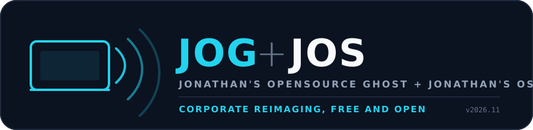

<p align="center">
  
</p>

<h1 align="center">JOG + JOS</h1>

<p align="center"><strong>Corporate reimaging, without the licence bill.</strong></p>

<p align="center">
  A free, portable, Secure Boot imaging appliance built on Ubuntu, FOG, and JOS.<br>
  Reimage a room of corporate laptops over multicast, then drive the full hybrid-join pipeline:
  drivers, domain join, AD groups, and BitLocker escrow.
</p>

<p align="center">
  
  
  
  
  
  
</p>

---

## What this is

**JOG** is the appliance: an Ubuntu laptop that runs stock FOG on an isolated imaging network, with a
kiosk, a guided installer, and a driver share. **JOS** is the client runtime: the Secure Boot-compatible
replacement for FOG's FOS that boots on the machine being imaged. Together they turn a blank corporate
laptop into a domain-joined, policy-ready, encrypted asset without a per-device licence.

The design goal is deliberately ambitious:

```text
PHASE 1 — MULTICAST IMAGING  (the under-5-minute target)
100 corporate laptops
        │
        ├── one multicast stream
        ├── one image
        └── one technician
                 │
                 ▼
        image applied + post-download injection
                 │
                 ▼
PHASE 2 — PROVISIONING  (separate, after imaging)
        drivers  →  domain join  →  Entra hybrid join
                 →  AD groups  →  BitLocker  →  escrow verified
                 │
                 ▼
             COMPLETE
```

The 5-minute figure is the **imaging-phase target only**. It covers the multicast transfer and the
post-download injection — not Windows first boot, driver installation, domain join, hybrid join, AD group
assignment, or BitLocker. Those run afterward as a resumable state machine and typically take tens of
minutes including reboots. The imaging math and the network checklist are in
[`docs/MULTICAST-100.md`](docs/MULTICAST-100.md).

---

## Why it exists

Corporate device refreshes are expensive for reasons that have little to do with hardware:

- Imaging tools are licensed per device or per technician.
- Secure Boot forces a choice between disabling it, enrolling a custom key on every machine, or buying
  another platform.
- Drivers, domain join, group membership, and BitLocker are usually four separate manual steps.
- The recovery key ends up in a spreadsheet, a share, or nowhere.

JOG + JOS is the opposite: **free and open source, self-contained, and auditable**. It preserves the FOG
workflow instead of replacing it, uses the standard Microsoft → Canonical Secure Boot chain, and turns the
post-image steps into a resumable state machine on the device.

---

## The pipeline

| Stage | Where it runs | What happens |
|---|---|---|
| **PXE + Secure Boot** | firmware → JOG | shim → signed GRUB → signed Ubuntu kernel → JOS initramfs |
| **Multicast image** | JOS client + FOG | one `udp-sender` stream, many `udp-receiver` clients, weak-link watchdog |
| **Post-download injection** | JOS client, after the image write | mounts the Windows partition and installs the JOG Provisioner payload + `SetupComplete.cmd` |
| **Drivers** | Windows first boot | `Install-JOGDrivers.ps1` reads `manifest.json`, installs the `VMD` base pack + model pack from `\\10.99.0.1\Drivers`, and runs `pnputil` |
| **Hostname** | Windows first boot | deterministic name from site code + serial/model |
| **Handoff** | Windows first boot | `AirGapped` default: writes `AWAITING-CORPORATE.txt` + desktop shortcut and removes secrets |
| **Domain join** | Corporate LAN, after resume | delegated credential join (fleet default) or offline `djoin` blob for one device/per-device blob |
| **Entra hybrid join** | Corporate LAN, after resume | waits for `dsregcmd /status` to report `AzureAdJoined: YES` + `DomainJoined: YES` |
| **AD groups** | Corporate LAN, after resume | delegated `net group` or server-side `Add-ADGroupMember` |
| **BitLocker** | Corporate LAN, after resume | TPM-only (recommended) or TPM+PIN, recovery password escrowed to AD and/or Entra ID |
| **Escrow verified** | Corporate LAN, after resume | the device only reaches `COMPLETE` after the recovery key is confirmed in the directory |

The full state machine, prerequisites, and failure/retry behaviour are in
[`docs/CORPORATE-PROVISIONING.md`](docs/CORPORATE-PROVISIONING.md).

### The BitLocker PIN question

**Active Directory does not store a BitLocker startup PIN.** AD stores the **48-digit BitLocker recovery
password** — the key displayed as eight groups of six digits — in `msFVE-RecoveryPassword` on an
`msFVE-RecoveryInformation` child object under the computer account. The six-digit startup PIN is a
separate pre-boot secret and is not escrowed by BitLocker or AD.

The recommended design is therefore:

- **TPM-only BitLocker** for corporate laptops (no pre-boot PIN), with the recovery password escrowed to
  AD and/or Entra ID.
- If the organisation requires **TPM + PIN**, the PIN is user-held and is **not** written to AD. It can be
  sealed locally with DPAPI or stored in a dedicated secrets manager.
- A custom AD attribute for the PIN is possible but is a security anti-pattern; the provisioner supports
  it only behind an explicit `AllowAdPinStorage` switch and logs a warning.

The exact attributes, LDAP path, PowerShell commands, and the recommended alternatives are in
[`docs/BITLOCKER-AD.md`](docs/BITLOCKER-AD.md).

---

## The three repositories

| Repo | Role | Runs on |
|---|---|---|
| **[jog](https://github.com/splippers/jog)** | The appliance: Ubuntu autoinstall, native FOG, isolated DHCP/TFTP, kiosk, driver share, multicast tuning, Windows provisioner payload, post-download injection | the JOG laptop (server) |
| **[jos](https://github.com/splippers/jos)** | The client runtime: Secure Boot chain, initrd build, GRUB menu, FOS userland, local-boot fallback, weak-link watchdog | the machine being imaged (client) |
| **jog-jos** (this repo) | Integration: pins `jog` and `jos` at known-good commits, combined docs, end-to-end design, roadmap | n/a |

**Rule of thumb:** if it configures the laptop or the FOG server, it belongs in `jog`. If it runs on, or
builds for, the imaged machine, it belongs in `jos`. If it describes how the two fit together, it belongs
here.

---

## Quick start

```bash
git clone --recurse-submodules https://github.com/splippers/jog-jos.git
cd jog-jos

# 1. Build the JOS client runtime
jos/build/build-from-fos.sh

# 2. Install the appliance helpers
sudo JOS_DIR=$PWD/jos jog/install/jog-install.sh

# 3. Configure the imaging network and install FOG
sudo jog-install-wizard

# 4. Stage the Secure Boot chain and verify it
sudo jog-stage-jos-boot.sh
jog-doctor.sh
```

Then, on the appliance:

```bash
# Driver share (Samba) — read-only for clients, write for the upload account
sudo jog-driver-share.sh --apply

# Multicast profile for the 100-laptop reference design
sudo jog-multicast-tune.sh --check
sudo jog-multicast-tune.sh --apply

# Default PXE entry auto-joins a waiting multicast session
sudo jog-autojoin-setup.sh --apply

# Corporate provisioning payload + FOG post-download injection
sudo jog-corporate-setup            # writes /etc/jog/provisioning.env, installs the payload
```

On a Windows 11 workstation with internet access, sync driver packs for every model FOG has inventoried:

```powershell
# Preview the models and catalog packs
.\Sync-FOGDriverPacks.ps1 -PlanOnly

# Download, extract, and publish to \\192.168.254.1\Drivers
.\Sync-FOGDriverPacks.ps1
```

The payload scripts live in [`jog/provisioner/windows/`](https://github.com/splippers/jog/tree/main/provisioner/windows).

---

## What is proven, and what is new

| Area | Status |
|---|---|
| Secure Boot chain (shim → GRUB → signed kernel → JOS) | Proven in the QEMU Secure Boot VM test; real-hardware validation ongoing |
| Unicast deploy/capture, registration, inventory, FOG menu parity | Proven on lab hardware |
| Multicast deploy | Implemented; default PXE auto-join endpoint added; 100-client reference profile and hardware proof pending |
| Driver share + Windows driver install | Implemented with FOG inventory → vendor catalog sync and a `manifest.json`; needs a model-pack validation pass |
| Domain join + Entra hybrid join | Implemented as a resumable Windows state machine with an air-gapped handoff; needs a lab AD/Entra tenant |
| AD group assignment | Implemented for delegated credential join; server-side helper for offline join |
| BitLocker + AD/Entra escrow | Implemented; the PIN/AD design is documented and defaults to TPM-only |
| 100-laptop multicast imaging in under 5 minutes | Imaging-phase reference target; measure on the actual switch fabric before quoting it |

The project is deliberately honest about this line. The core imaging chain is real and has been run on
hardware. The corporate provisioning layer is new code and should be validated in a lab directory before
it touches production devices.

---

## Documentation

| Document | What it answers |
|---|---|
| [`docs/CORPORATE-PROVISIONING.md`](docs/CORPORATE-PROVISIONING.md) | The end-to-end pipeline, state machine, credentials, retries, and test plan |
| [`docs/BITLOCKER-AD.md`](docs/BITLOCKER-AD.md) | Where BitLocker recovery data lives in AD, why the PIN is different, and the recommended design |
| [`docs/MULTICAST-100.md`](docs/MULTICAST-100.md) | The 100-client math, FOG settings, network design, and benchmark checklist |
| [`docs/BRAND.md`](docs/BRAND.md) | JOG/JOS naming, voice, palette, and asset usage |
| [`ROADMAP.md`](ROADMAP.md) | The longer-term plan and the decisions still open |
| [`jos/README.md`](https://github.com/splippers/jos) | The client runtime internals |
| [`jog/README.md`](https://github.com/splippers/jog) | The appliance internals |

---

## Licence

MIT. FOG is GPL-3; JOS builds on the unmodified FOG userland and ships the FOG client code under its own
licence. See each repository's `LICENSE` for details.
